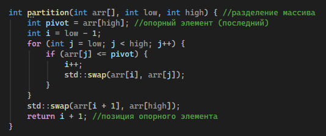
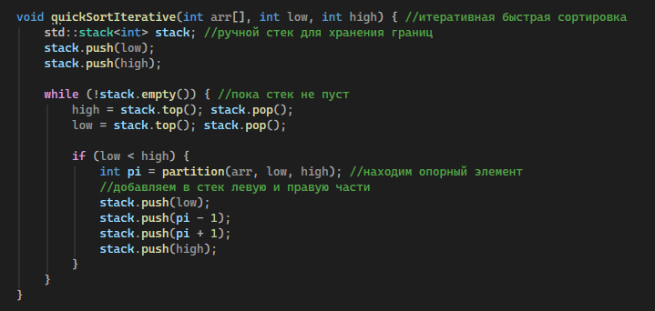
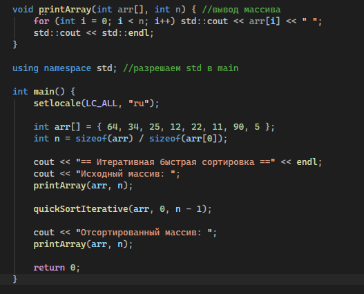

# Отчет к лабораторной работе № 7
# Тема: Быстрая сортировка, сортировка слиянием, пирамидальная сортировка
# Дисциплина: Алгоритмы и структуры данных
## Выполнил: Бойко Андрей Сергеевич ПИЖ-б-о-25-2
# Цель:
1. Реализовать три эффективных алгоритма сортировки: быструю сортировку (Quick Sort), сортировку слиянием (Merge Sort) и пирамидальную сортировку (Heap Sort) 
2. Освоить принципы «разделяй и властвуй» на примере быстрой сортировки и сортировки слиянием 
3. Изучить структуру данных «куча» (heap) для реализации пирамидальной сортировки 
4. Проанализировать и сравнить производительность различных алгоритмов сортировки 
5. Понять преимущества и недостатки каждого алгоритма в различных сценариях использования 
# Ход работы

Написал функцию разделения. Она берет последний элемент в качестве опорного (pivot). Затем она проходит по массиву и переставляет элементы так, чтобы слева от pivot оказались все элементы меньше него, а справа - больше. В конце она ставит pivot на его прежнее место и возвращает его индекс.

Обычная быстрая сортировка использует рекурсию. Здесь рекурсия заменена на стек.
1. Сначала мы кладем в стек начальный индекс (0) и конечный (n-1).
2. Запускается цикл while, который работает, пока стек не пуст.
3. Внутри цикла мы достаем из стека текущие границы (low и high).
4. Если low < high, мы вызываем partition, чтобы найти опорный элемент (pi).
5. Затем мы кладем в стек границы двух новых подмассивов: левого (low до pi - 1) и правого (pi + 1 до high).
Цикл повторяется, пока все подмассивы не будут обработаны.

Написал функцию вывода массива и main для демонстрации работы программы.
# Вывод:
1. Реализовали три эффективных алгоритма сортировки: быструю сортировку (Quick Sort), сортировку слиянием (Merge Sort) и пирамидальную сортировку (Heap Sort) 
2. Освоили принципы «разделяй и властвуй» на примере быстрой сортировки и сортировки слиянием 
3. Изучили структуру данных «куча» (heap) для реализации пирамидальной сортировки 
4. Проанализировали и сравнили производительность различных алгоритмов сортировки 
5. Поняли преимущества и недостатки каждого алгоритма в различных сценариях использования 
# Ответы на контрольные вопросы:
1 Лучший и средний случай - O(n log n), а худший случай - O(n^2).
2 Худший случай возникает, когда опорный элемент каждый раз оказывается минимальным или максимальным, что приводит к сильно несбалансированному разделению (например, на уже отсортированном массиве).
3 Для защиты от худшего случая используют случайный выбор опорного элемента, метод «медианы трёх» (выбор среднего из первого, последнего и центрального) или трёхпутевое разделение.
4 Сложность всегда O(n log n), потому что массив на каждом шаге делится ровно пополам (глубина рекурсии log n), а на каждом уровне происходит слияние всех n элементов за линейное время.
5 Преимущество слияния - гарантированная сложность O(n log n) в любом случае и устойчивость; недостаток - требует O(n) дополнительной памяти, тогда как быстрая сортировка работает на месте.
6 Сначала массив превращают в двоичную кучу (max-heap), затем максимальный элемент (корень) меняют местами с последним, уменьшают размер кучи и восстанавливают её свойства; сложность - O(n log n).
7 Устойчивая только сортировка слиянием, так как при слиянии она сохраняет относительный порядок элементов с одинаковыми значениями; быстрая и пирамидальная - неустойчивые.
8 Дополнительная память нужна сортировке слиянием - O(n) для временных массивов; быстрая требует O(log n) из-за стека рекурсии, а пирамидальная работает за O(1) на месте.
9 Быстрая сортировка с правильным выбором опорного элемента (или сортировка вставками для маленьких массивов) работает быстрее всего, так как делает меньше перестановок.
10 Куча строится для того, чтобы самый большой элемент оказался в корне; это позволяет за O(1) находить максимум и за O(log n) восстанавливать структуру после его извлечения.
11 Это стратегия, при которой задачу делят на подзадачи меньшего размера, решают их рекурсивно и объединяют результаты; в быстрой сортировке делят по опорному элементу, а в слиянии - пополам.
12 Да, можно, если заменить системный стек вызовов на ручной (например, std::stack), куда мы будем класть индексы начала и конца подмассивов для обработки.
13 Быстрая сортировка быстрее на практике из-за лучшей локальности кэша (последовательный доступ к памяти) и меньшего количества операций обмена, несмотря на одинаковую теоретическую сложность.
14 Пирамидальную сортировку выгодно использовать, когда критична гарантия худшего случая O(n log n) и жестко ограничена память (например, во встроенных системах), так как она не требует дополнительной памяти.
15 Для встроенных систем с ограниченной памятью лучше всего подойдет пирамидальная сортировка, так как она требует O(1) дополнительной памяти, не использует рекурсию и гарантирует O(n log n) в худшем случае.

